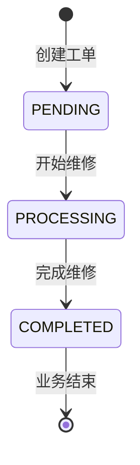
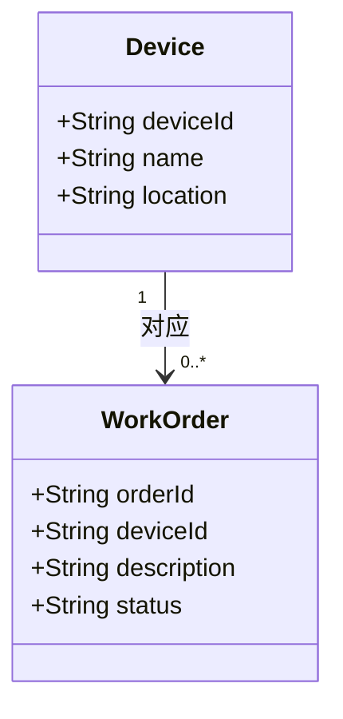

# 状态图与简单类图
 
本文件对应实验一的分工 B：状态图、简单类图及其源材料。
状态取值只有三个：待处理 `PENDING`、处理中 `PROCESSING`、已完成 `COMPLETED`。
 
## 1 状态图
 

 
读图说明：
 
1. **唯一入口**：工单创建后直接进入 `PENDING`（待处理），不存在其他初始状态。
2. **两个事件**：`开始维修` 把工单从 `PENDING` 推到 `PROCESSING`；`完成维修` 把它从 `PROCESSING` 推到 `COMPLETED`。
3. **终态**：`COMPLETED` 是本次业务终态，箭头指向结束符，不画"重新打开""撤销""退回处理中"等扩展路径。
4. **为什么图上只有两条箭头**：状态图只画**允许**的转换。被拒绝的 7 种组合（跳级 `PENDING→COMPLETED`、回退 `COMPLETED→PROCESSING` 与 `PROCESSING→PENDING`、相同状态三种、以及 `COMPLETED→PENDING`）如果也画成箭头，会让读者误以为系统支持这些操作。拒绝逻辑由 `docs/requirements.md` 第 4 节的转换矩阵和 `src/java/StatusRule.java` 的 `canTransition` 保证。
 
## 2 简单类图
 

 
读图说明：
 
1. `Device` 只保留三个属性：设备编号 `deviceId`、名称 `name`、位置 `location`，与 `data/devices.csv` 的三列一一对应。
2. `WorkOrder` 保留四个属性：工单号 `orderId`、设备编号 `deviceId`、故障描述 `description`、状态 `status`；`status` 的取值只能是 `PENDING`、`PROCESSING`、`COMPLETED`。
3. **多重性**：`Device "1" --> "0..*" WorkOrder`，读作"一台设备对应 0 到多张工单，每张工单对应 1 台设备"。0 表示设备完好时没有任何工单，多表示同一设备可以反复报修。
4. 本次只分析结构，不实现 `Device` 和 `WorkOrder` 两个实体类，也不设计数据库表。
 
## 3 与需求的一致性检查
 
- [x] 中文状态与程序英文值一一对应：待处理=`PENDING`、处理中=`PROCESSING`、已完成=`COMPLETED`
- [x] 状态图中被允许的转换只有两条，与 FR-03 转换矩阵一致
- [x] `COMPLETED` 画成终态，没有重新打开或回退路径
- [x] 一台设备与多张工单的关系及多重性标注清楚
- [x] 类图属性覆盖 `Device` 三项与 `WorkOrder` 四项，且不擅自增加数据库字段
- [x] 类图中未把数据库、传感器硬件画成类
 
| 需求 | 状态图中的对应 | 类图中的对应 |
| --- | --- | --- |
| FR-02 提交报修 | 入口直接进入 `PENDING` | `WorkOrder` 新增一条记录，`status=PENDING` |
| FR-03 更新工单状态 | `PENDING→PROCESSING`、`PROCESSING→COMPLETED` 两条箭头 | `WorkOrder.status` 取值变化，`deviceId` 指向对应 `Device` |
| FR-01 查看设备信息 | 不涉及状态变化 | 读取 `Device` 的 `deviceId`、`name`、`location` |
 
## 4 源材料说明
 
- 两份图都使用 Mermaid 语法写在本文档的代码块中，**代码块本身就是可编辑源材料**（实验指导书允许此方式，无需另附绘图工程文件）。
- 在 GitHub 网页打开本文件时，Mermaid 会自动渲染成图；本地用 Typora、VS Code 或 mermaid.live 也能渲染。
- 若后续改为导出图片，需把图片放在 `docs/assets/`，并在本文档中用相对路径（如 `assets/state.png`）引用，同时提交绘图源文件。
