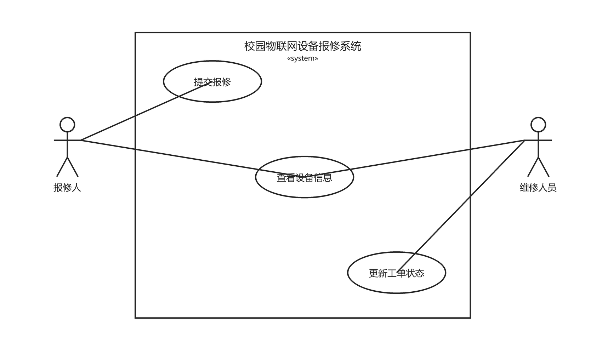

# 用例图与角色说明

## 1 用例图

图片使用相对路径 `assets/usecase.png` 引用，与本文档同处 `docs` 目录下，换电脑或直接在 GitHub 网页预览都能正常显示。

## 2 参与者与用例

| 编号 | 用例 | 参与者 | 目标 | 关联需求 |
| --- | --- | --- | --- | --- |
| UC-01 | 查看设备信息 | 报修人、维修人员 | 按设备编号查到设备的名称与位置 | FR-01 |
| UC-02 | 提交报修 | 报修人 | 为清单内设备生成一张待处理工单 | FR-02 |
| UC-03 | 更新工单状态 | 维修人员 | 把工单从待处理推进到处理中、再到已完成 | FR-03 |

## 3 用例简述

### UC-01 查看设备信息

- **参与者**：报修人、维修人员（两者都有查看权限，这是三个用例中唯一对双方开放的一个）。
- **前置条件**：设备清单已加载。
- **主流程**：参与者给出设备编号 → 系统在清单中查找 → 显示编号、名称、位置。
- **异常流程**：编号不存在时提示"设备不存在"；编号为空时提示"请输入设备编号"。
- **后置结果**：只读，不产生也不修改任何数据。

### UC-02 提交报修

- **参与者**：报修人。
- **前置条件**：设备已存在于清单中。
- **主流程**：报修人选择设备并填写故障描述 → 系统校验设备存在且描述非空 → 生成工单，状态置为 `PENDING` → 返回工单号。
- **异常流程**：故障描述为空时不创建工单；设备编号不在清单内时不创建工单。
- **后置结果**：新增一张状态为 `PENDING` 的工单。

### UC-03 更新工单状态

- **参与者**：维修人员。
- **前置条件**：工单已存在，当前状态为 `PENDING`、`PROCESSING`、`COMPLETED` 之一。
- **主流程**：维修人员给出工单号与目标状态 → 系统判断该转换是否被允许 → 允许时更新状态，拒绝时保持原状并提示。
- **允许的转换**：`PENDING → PROCESSING`（开始维修）、`PROCESSING → COMPLETED`（完成维修）。
- **异常流程**：跳级（`PENDING → COMPLETED`）、回退（`COMPLETED → PROCESSING`、`PROCESSING → PENDING`）与相同状态转换一律拒绝。
- **后置结果**：状态被更新，或原状态保持不变。

## 4 系统边界与画法说明

- 系统边界为矩形，名称"校园物联网设备报修系统"，边界内只放 UC-01、UC-02、UC-03 三个用例。
- 矩形外只有两个参与者：报修人在左，维修人员在右。
- 参与者与用例之间用**无箭头的实线**表示关联（参与者发起用例），不用箭头表示数据流。
- 设备本身、数据库、GitHub 都不是操作者，因此**不画成参与者**；设备只是被查询的数据来源。
- 本次业务没有公共子流程，因此不使用 `«include»` 与 `«extend»`，避免把简单的三用例关系复杂化。

权限关系与需求一致：

| 参与者 | 可发起的用例 |
| --- | --- |
| 报修人 | UC-01、UC-02 |
| 维修人员 | UC-01、UC-03 |

## 5 图的自查

- [x] 两个参与者：报修人、维修人员
- [x] 三个主要用例：查看设备信息、提交报修、更新工单状态
- [x] 系统边界清楚，边界内没有多余元素
- [x] 参与者与用例连接正确：报修人连 UC-01/UC-02，维修人员连 UC-01/UC-03
- [x] 设备、数据库未被画成操作者
- [x] 源文件与导出图内容一致
- [x] 说明文件使用相对路径引用图片，未使用本机磁盘路径

## 6 可编辑源文件

- `docs/assets/usecase.drawio`：用 draw.io（diagrams.net）打开后可修改图形与文字。
- 修改源文件后必须重新导出并覆盖 `docs/assets/usecase.png`，保证源文件与图片内容一致；两者不一致时以图片无法通过自查处理，需要重新导出。
